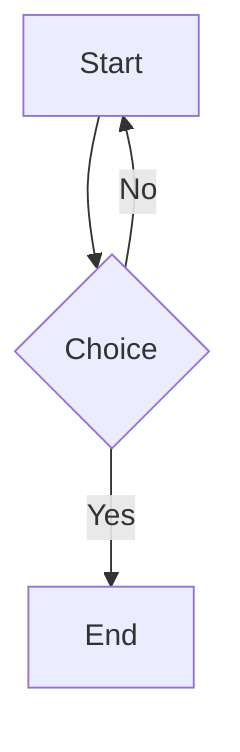

# Spaceboy Theme: Content and Customization Guide

Spaceboy is a Hugo blog theme with light/dark mode, responsive layouts, search, shortcodes, image zoom, and build-time Mermaid and KaTeX rendering. This guide describes the current theme and shows how to create content, change its appearance, and extend its templates.

The theme requires **Hugo 0.132 or newer**. Examples assume the theme is installed at `themes/spaceboy` and that commands run from the site root unless stated otherwise.

## Quick start

Use this site structure:

```text
my-site/
├── hugo.toml
├── content/
│   └── posts/
│       └── hello-world.md
├── assets/
│   └── css/
│       └── override.css
├── static/
└── themes/
    └── spaceboy/
```

Place the Spaceboy repository in `themes/spaceboy`. Start with this `hugo.toml`:

```toml
baseURL = "https://example.com/"
title = "My Site"
theme = "spaceboy"
mainSections = ["posts"]

# Exclude the demo content packaged in the theme repository.
ignoreFiles = ["spaceboy/content/.*"]

# JSON is required by the built-in search index.
[outputs]
  home = ["HTML", "RSS", "JSON"]
  page = ["HTML"]

[params]
  [params.author]
    name = "Your Name"

  [[params.nav]]
    name = "Home"
    link = "/"

  [[params.nav]]
    name = "About"
    link = "/about"
```

Create `content/posts/hello-world.md`:

```markdown
---
title: "Hello World"
date: 2026-01-01
draft: false
tags: ["hugo"]
categories: ["Tech"]
---

This is my first Spaceboy post.
```

Run the site:

```bash
hugo server -D
```

Open the local URL printed by Hugo. Remove `-D` when you do not want draft pages in the build.

## Create content

### Sections and `mainSections`

Hugo uses the first directory under `content/` as the page type unless front matter sets `type`. For example, `content/posts/my-post.md` has type `posts`.

`params.mainSections` controls which regular pages appear on the home page, in related posts, in search, and in share links. Add every content section that should behave like a post:

```toml
[params]
  mainSections = ["posts", "notes", "docs"]
```

A standalone page such as `content/about.md` is not part of that list unless you give it a matching `type`.

### Page bundles and images

Use a page bundle when images belong to one post:

```text
content/
└── posts/
    └── my-post/
        ├── index.md
        ├── cover.webp
        └── diagram.png
```

Reference bundle resources by relative path:

```markdown

```

The image render hook resizes bundle images to a width of 1200 pixels and emits width and height attributes. Files under `static/` are copied unchanged; reference them with a root-relative path such as `/images/cover.webp`.

### Useful front matter

```yaml
---
title: "Post title"
date: 2026-01-01
lastmod: 2026-02-01
draft: false
type: posts
description: "A short description for search and social metadata."
tags: ["hugo", "docs"]
categories: ["Tech"]
coverImage: "/images/cover.webp"
---
```

- `description` overrides the generated meta description.
- `coverImage` is shown above the title and used for social sharing.
- `heroImage` is also shown above the title, with a taller maximum height.
- `tags` and `categories` use Hugo taxonomies.
- `series` links posts that share the same series name.
- `author.homepage` links the site author name in the post meta line.

## Parameter precedence

Most display parameters use Hugo's parameter lookup: a page value overrides the same value in `hugo.toml [params]`. The reference below marks options that are read only from page front matter.

`viewMode` supplies defaults. An explicit page value overrides those defaults, including `false`. For example, a docs page can set `progressBar: false`, `showReadingTime: false`, or `numberedHeadings: false`.

The granular meta and footer switches also override `noMeta` or `hideFooter`. One visual exception is `goofy`: its CSS hides metadata and footer elements with `!important`, so template switches alone do not bring them back. Override that CSS or the head partial when you need a different goofy layout.

## Typography

### Font Family

The `font` parameter replaces `--font-body` for the entire page — headings, nav, and body text.

By default (no `font` parameter), `--font-body` uses **Atkinson Hyperlegible** (Google Fonts), a highly-legible sans-serif designed for low-vision readers.

| Value | Renders as | Best for |
|---|---|---|
| *(none)* | Atkinson Hyperlegible *(default)* | General reading, accessibility |
| `mono` | JetBrains Mono | Tech posts, code-heavy writing |
| `serif` | Georgia → Charter → Palatino | Stories, novels, essays, research |
| `sans` | system-ui → Segoe UI → Roboto | Short-form, recipes, reviews |
| any CSS string | Custom font stack | Total control |

```yaml
font: serif
```


`font: serif` also sets `--letter-spacing-normal: 0.01em` and `--line-height-body: 1.9` automatically — both improve serif body readability without any extra config.


### Drop Cap

Enlarges the first letter of the first paragraph using CSS `::first-letter`. No markup changes needed.

```yaml
dropCap: true
```

Best paired with `font: serif` and `contentWidth: normal`.

### Justified Text

Applies `text-align: justify` with automatic hyphenation to paragraphs only. Headings and blockquotes stay left-aligned.

```yaml
justify: true
```

Use for essays, formal writing, or long-form prose where you want the clean block-edge look.

### Opening Epigraph

A centred italic quote rendered before the post body. Set directly in front matter for a simple string:

```yaml
epigraph: "Not one of these dreams has fulfilled me, nor have I expected them to."
```

For author attribution use the `` shortcode instead — see [Shortcodes](#shortcodes).

### View modes

`viewMode` supplies a small set of layout and display defaults. It does not load a different template.

| Mode | Defaults | Best for |
|------|----------|----------|
| `docs` | Numbered headings, reading time, progress bar, taller code blocks | Tutorials, reference, code-heavy posts |
| `poem` | No meta or footer, centered text, larger type, narrower column | Poetry |
| `goofy` | Drop cap, justified text, no meta or footer, larger type, static header | Stories and distraction-free reading |
| `minimal` | No meta or footer, wide column, hidden site footer, `noindex` unless explicitly set | Scratch pages and unlisted pages |

```yaml
viewMode: docs
```

Only `docs`, `poem`, `goofy`, and `minimal` are recognized. Older mode names and named color palettes are not supported. Use `font`, `contentWidth`, and the display switches for other combinations.

`docs` does not enable the table of contents. Add `showToc: true` when you want it. See [Parameter precedence](#parameter-precedence) before trying to disable a default with `false`.

## Layout

### Content Width

```yaml
contentWidth: normal   # clamp(320px, 95vw, 1200px) — default, good for most posts
contentWidth: wide     # clamp(320px, 95vw, calc((1200px + 100vw)/2)) — between normal and full
contentWidth: full     # 100% — comics, photography, full-bleed layouts
```


`normal` (clamp up to 1200px) is a comfortable reading width. For even more space use `wide`.


### Cover and hero images

Both images appear above the post title. `coverImage` is also used for Open Graph and structured-data images. `heroImage` allows a taller image but is not used as the social image.

```yaml
coverImage: "/images/cover.webp"
heroImage: "/images/tall-header.webp"
```

Use one unless you need two different banners. For the site-wide social fallback, set `params.ogImage`.

### Image and diagram zoom

The built-in lightbox opens post-body images and Mermaid diagrams when clicked. It is implemented by the theme JavaScript; no Fancybox asset or `lightbox` front-matter key is required. Cover and hero images are excluded, as are images inside links.

Set `legacyMode: true` to disable this enhancement and the other optional JavaScript behavior.

### Full-Bleed Images

Stretches every image inside `post-content` to viewport width, breaking out of the content column.

```yaml
imageFullBleed: true
```


Works best with `contentWidth: full` and `showToc: false`. In the three-column TOC layout the grid clips the bleed.


### Code Block Height

The default max-height for code blocks is `32rem` — beyond that the block scrolls. Override or remove the limit:

```yaml
codeMaxHeight: "50rem"   # taller blocks
codeMaxHeight: "none"    # no limit, full code always visible
```

## Post Meta

### Reading Progress Bar

A 3px bar at the top of the viewport that fills as you scroll. No layout impact.

```yaml
progressBar: true
```

### Reading Time

Shows "X min read" in the post meta line. Hugo estimates ~200 words/minute.

```yaml
showReadingTime: true
```

### Last Modified Date

Appears only when `lastmod` differs from `date` — ideal for docs and tutorials that get updated.

```yaml
showLastModified: true
```

```yaml
date: 2026-01-15
lastmod: 2026-05-29
```

### Numbered Headings

Prepends `1.`, `1.1`, `1.1.1` counters to h2, h3, h4 via CSS. No content changes needed.

```yaml
numberedHeadings: true
```

### Hide Meta Block

`noMeta: true` defaults the date, author, and word-count switches to off. Reading time and last-modified values have their own switches, so also set those to off if you want no metadata at all.

```yaml
noMeta: true
showReadingTime: false
showLastModified: false
```

An explicit `noMeta: false` overrides a view-mode default. In `goofy`, the mode's CSS still hides metadata with `!important`; use a CSS or template override to change that.

### Hide Post Title

Suppresses the `<h1>` rendered from the `title:` front matter field. Use when providing a decorative title inside the post body via the `chapter` shortcode. The exact key is `show-title`, with a hyphen; `showTitle` is not read by the current template.

```yaml
show-title: false
```

### Hide Footer Block

Removes tags, related posts, ads, and comments from the bottom of the page. Useful for poems, visual essays, and pages where post-footprint content feels cluttered.

```yaml
hideFooter: true
```

Set automatically by `viewMode: goofy`, `viewMode: poem`, and `viewMode: minimal`.

### Granular Section Toggles

Fine-grained control over individual meta and footer elements. Each defaults to respecting the parent flag (`noMeta` / `hideFooter`), but can be set independently.

**Meta toggles** (beat `noMeta`):

| Param | Default | What it controls |
|---|---|---|
| `showDate` | `not $noMeta` | Publish date in meta |
| `showAuthor` | `not $noMeta` | Author name in meta |
| `showWordCount` | `not $noMeta` | Word count in meta |

```yaml
showDate: false      # hide date, keep author and word count
showAuthor: true
showWordCount: true
```

**Footer toggles** (beat `hideFooter`):

| Param | Default | What it controls |
|---|---|---|
| `showTags` | `not $hideFooter` | Tags section |
| `showShare` | `not $hideFooter` | Social share buttons |
| `showRelatedPosts` | `not $hideFooter` | Related posts section |
| `showPostNav` | `not $hideFooter` | Prev/next navigation |
| `showComments` | `not $hideFooter` | Comments section |

```yaml
showShare: false      # hide only share buttons, keep everything else
showRelatedPosts: false
showTags: true
showPostNav: true
```

### Color scheme

Spaceboy has exactly two color states: light and dark. On first load it follows the operating-system preference. The header button or `t` key pins a choice for the current browser session; there is no palette picker and no third state.

Customize colors with the CSS variables in `themes/spaceboy/assets/css/index.css`, or override those variables from your site. See [Customize colors and typography](#customize-colors-and-typography).

The per-page `author.homepage` param wraps the site author name in a hyperlink in the post meta line. It does not change the author name.

```yaml
author:
  homepage: "https://example.com"
```

### Abstract Block

A left-bordered italic block rendered before the body text. For research papers and technical reports.

```yaml
abstract: "One paragraph summary of what this post covers and why it matters."
```

### Thumbnail in List View

Shows a thumbnail in list view (hamburger toggle on homepage), with a dim overlay so text stays readable.

```yaml
showThumbnailInList: true
```

### Thumbnail in Catalog View

Same as above but for the grid (catalog) view — image becomes the card background with a dim overlay.

```yaml
showThumbnailInCatalog: true
```

### Explicit Thumbnail URL

By default the thumbnail is auto-extracted from the first markdown image in the post. Use `thumbnail` to set a specific URL instead:

```yaml
thumbnail: /images/my-custom-thumb.webp
showThumbnailInList: true
```

Overrides the auto-extraction completely. Useful when the first in-post image isn't suitable as a card thumbnail.

## Table of Contents

```yaml
showToc: true
```

Activates the three-column layout: left sidebar (full chapter overview), main content, right sidebar (sub-sections of the current section). On screens below 768px both sidebars hide and a toggle button appears above the content.

The right sidebar shows sub-headings under the active section. When those sub-headings are identical to what the left sidebar already shows (e.g. a post with only h2s and no h3s), the right sidebar displays "No sub headings" instead of repeating the same list.

Clicking a TOC link smooth-scrolls the heading to just below the sticky header — the same `scroll-margin-top: 90px` offset used by native `#hash` jumps, so the heading is never buried at the vertical center of the viewport. The active highlight is applied once the scroll completes, so the sidebar tracks the clicked heading correctly when navigating in either direction (e.g. jumping from the last section back to an earlier one).

Configure the sidebar labels in `hugo.toml`:

```toml
[params]
  tocTitle    = "Contents"        # left sidebar header
  tocSubTitle = "In this section" # right sidebar header
```

## HR Separators

Controls how `---` in Markdown renders.

```yaml
hrStyle: small   # 4em centred line — scene breaks in fiction
hrStyle: full    # 100% width — section dividers in docs
hrStyle: 40%     # any CSS length value
```

## Shortcodes

### Callouts

Five variants: `note`, `tip`, `warning`, `danger`, `info`. All accept an optional `title` param.

```
 Information worth highlighting. 
 A helpful suggestion. 
 Caution before proceeding. 
 Potential data loss or breakage. 
 Neutral supplemental context. 
```


`git reset --hard` discards all uncommitted changes permanently.


### Epigraph

A centred italic opening quote. Accepts `author` and `source` params.

```
 There was a wall. 
```

For multi-line quotes, write the shortcode tags on their own lines. Hugo processes them correctly when the inner content is on a separate line.

### Chapter Title

A decorative chapter heading. Use with `show-title: false` so the front matter title is suppressed.

```
 The Long Way Home 
```

Renders a small caps chapter label above the main title text.

### Spoiler

A collapsible `<details>` block. Default label is "Spoiler — click to reveal".

```
 The lighthouse was a metaphor all along. 
```

### Poem

Centres and italicises the content. Use two trailing spaces at end of each line for line breaks; an empty line between stanzas.

```
 last train — / window cracked — / smell of rain 
```

In actual use, write each line on its own with two trailing spaces:

```markdown

last train of the night —  
someone left a window cracked  
the smell of rain gets in

```


The multi-line form above works fine in post content. The single-line form shown in code is just to avoid documentation rendering issues.


### Details / Accordion

A collapsible block for supplemental content — ingredient lists, optional steps, extended notes.

```
 - 1½ cups rice / - 6 garlic cloves 
```

### Star Rating

Positional argument is the score; `max` is optional (defaults to 5).

```
    →   8/10
           →         4/5
```

### Keyboard Keys

Inline keyboard key styling.

```
Press Ctrl + S to save.
```

### Center

Wraps content in a centered `<div>`.

```
 This text will be centred. 
```

### KaTeX (Math)

Use `$...$` for inline math and `$$...$$` for display math directly in Markdown — no shortcode needed.

```markdown
The sigmoid $f(x) = \frac{1}{1 + e^{-x}}$ maps any value to (0, 1).

$$
\sum_{k=1}^{n} k = \frac{n(n+1)}{2}
$$
```

Math is **pre-rendered at build time** — no KaTeX JS loads at runtime. After adding new expressions, run `npm run build:diagrams` and commit `data/katex-cache.json`.

---

## Advanced Features

### KaTeX (Math Rendering)

Math expressions (`$...$` inline, `$$...$$` block) are **pre-rendered to HTML at build time** via `scripts/render-katex-cache.mjs`. No KaTeX JS loads at runtime — only KaTeX CSS is needed for styling.

**Build workflow:**
1. Write `$...$` or `$$...$$` in your post
2. Run `npm run build:diagrams` — updates `data/katex-cache.json`
3. Commit the updated cache file

**Detection heuristic:** inline `$...$` is only treated as math if the content contains a LaTeX command (`\frac`, `\sum`, etc.) or `^`/`_`. This avoids false positives from JavaScript `$('selector')` patterns.

Customise the KaTeX CSS CDN in `hugo.toml`:

```toml
[params]
  katexCSSCDN = "https://cdn.jsdelivr.net/npm/katex@0.16.21/dist/katex.min.css"
```

### Mermaid (Diagrams)

Render diagrams from text using fenced code blocks with ` ```mermaid `:

````

````

Diagrams are **pre-rendered to SVGs at build time** via `scripts/render-mermaid-cache.mjs`. No Mermaid JS loads at runtime. SVGs use CSS variables so they adapt to the active color palette automatically.

**Build workflow:**
1. Add a ` ```mermaid ` block to your post
2. Run `npm run build:diagrams` — renders SVGs into `static/mermaid-cache/`
3. Commit the new SVG and the updated `data/mermaid-manifest.json`

### Raw HTML

Use the `rawhtml` shortcode when you deliberately need raw HTML inside Markdown:

```markdown

<div class="custom-panel">Custom HTML</div>

```

The shortcode bypasses Hugo escaping. Do not use it with untrusted content.

---

## Per-Post Injections

Inject custom code into individual posts without touching theme files.

### Custom CSS

Inline CSS injected in `<head>`, scoped to this page only.

```yaml
customCSS: |
  .my-special-box {
    background: linear-gradient(135deg, #667eea, #764ba2);
    padding: 2rem;
    border-radius: 12px;
    color: white;
  }
```

### Custom JS

Inline JavaScript injected before `</body>`.

```yaml
customJS: |
  document.querySelectorAll('.my-special-box').forEach(function(el) {
    el.addEventListener('click', function() {
      alert('Clicked!');
    });
  });
```

### Custom Head

Raw HTML injected in `<head>`. Useful for per-page meta tags, schema, fonts, or preloads.

```yaml
customHead: |
  <meta name="theme-color" content="#667eea">
  <link rel="preload" href="/fonts/special.woff2" as="font" crossorigin>
```

## SEO Controls

### noindex

Adds `<meta name="robots" content="noindex">` so search engines skip this page.

```yaml
noindex: true
```

### noSearch

Excludes a post from `/index.json`, the site's search index. The exact key is `noSearch`; `searchExclude` is not read by the current theme.

```yaml
noSearch: true
```

Search also requires `JSON` in the home-page outputs, as shown in [Quick start](#quick-start).

---

## Content recipes

Add the relevant keys to a normal front-matter block that already contains `title`, `date`, and `draft`.

### Story or short story

```yaml
viewMode: goofy
```

`goofy` already enables the drop cap and justified text. Open the body with an `epigraph` shortcode when needed.

### Novel chapter

```yaml
viewMode: goofy
show-title: false
```

Use the `chapter` shortcode for the visible title and the `epigraph` shortcode for an opening quotation.

### Essay

```yaml
font: serif
justify: true
contentWidth: normal
```

### Research paper

```yaml
viewMode: docs
showToc: true
showLastModified: true
justify: true
abstract: "One paragraph summary of the paper."
```

### Technical documentation

```yaml
viewMode: docs
showToc: true
showLastModified: true
numberedHeadings: true
```

Use callouts for cautions, `details` for optional material, and `kbd` for keyboard shortcuts.

### Step-by-step tutorial

```yaml
viewMode: docs
showToc: true
```

Structure headings as `## 1. Install`, `## 2. Configure`, and `## 3. Run`.

### Recipe

```yaml
font: sans
```

Put ingredients in a `details` shortcode and instructions in normal Markdown.

### Review

```yaml
font: sans
```

Use `rating` for the score and `spoiler` for plot details.

### Comic or visual post

```yaml
contentWidth: full
imageFullBleed: true
showToc: false
hideFooter: true
```

Place each image on its own line. Use descriptive alt text. The built-in lightbox opens body images when clicked.

### Poem

```yaml
viewMode: poem
show-title: false
```

Use `chapter` for a decorative title and `poem` for centered stanzas. End each line with two spaces for a Markdown line break.

### Devlog or changelog

```yaml
viewMode: docs
showLastModified: true
```

Use `## Week of YYYY-MM-DD` or `## vX.Y.Z` headings.

### Reading list or link log

```yaml
font: sans
showToc: true
```

### Photo essay

```yaml
viewMode: minimal
noindex: false
coverImage: "/images/cover.webp"
font: serif
```

`minimal` defaults to `noindex`. Set `noindex: false` explicitly when the page should be indexed.

### Multi-part series

Give every part the same `series` value:

```yaml
series: "Building a Hugo theme"
```

The theme orders parts by date and shows a series navigation box when more than one page shares the name.

## Front-matter reference

`Page/site` means the template uses Hugo's parameter lookup, so the same key can also be set under `[params]`. `Page only` means the current template reads the key directly from the page.

### Core content

| Key | Type | Scope | Purpose |
|---|---|---|---|
| `title` | string | Page only | Post title and default social title |
| `date` | date/time | Page only | Publication date and ordering |
| `lastmod` | date/time | Page only | Modified date; Hugo may also derive it |
| `draft` | bool | Page only | Exclude from normal builds |
| `type` | string | Page only | Override the section-derived content type |
| `description` | string | Page only | Meta and social description |
| `tags` | list | Page only | Hugo tag taxonomy |
| `categories` | list | Page only | Hugo category taxonomy |
| `series` | string | Page only | Group posts into an ordered series |
| `coverImage` | string | Page only | Banner above the title and social-image fallback |
| `heroImage` | string | Page only | Taller banner above the title |
| `epigraph` | string | Page only | Simple opening quotation |
| `abstract` | string | Page only | Summary block before the body |
| `author.homepage` | string | Page only | Link on the site author name |

### Layout and typography

| Key | Type | Scope | Values or effect |
|---|---|---|---|
| `viewMode` | string | Page/site | `docs`, `poem`, `goofy`, `minimal` |
| `font` | string | Page only | `serif`, `sans`, `mono`, or a CSS font stack |
| `dropCap` | bool | Page/site | Large first letter |
| `justify` | bool | Page/site | Justified paragraphs with hyphenation |
| `contentWidth` | string | Page/site | `normal`, `wide`, `full`, or a CSS width |
| `imageFullBleed` | bool | Page/site | Let body images extend to the viewport |
| `codeMaxHeight` | string | Page/site | CSS length, or `none` |
| `hrStyle` | string | Page/site | `small`, `full`, or a CSS width |
| `showToc` | bool | Page only | Show desktop sidebars and the mobile TOC |
| `tocTitle` | string | Page/site | Main TOC label; default `Contents` |
| `tocSubTitle` | string | Page/site | Subsection label; default `In this section` |
| `numberedHeadings` | bool | Page/site | Add CSS heading counters |
| `progressBar` | bool | Page/site | Show reading progress |

### Metadata and footer

| Key | Type | Scope | Effect |
|---|---|---|---|
| `showReadingTime` | bool | Page/site | Show estimated reading time |
| `showLastModified` | bool | Page/site | Show updated date when it differs |
| `noMeta` | bool | Page/site | Default date, author, and word count off |
| `show-title` | bool | Page only | Set to `false` to hide the rendered H1 |
| `showDate` | bool | Page only | Override the date switch |
| `showAuthor` | bool | Page only | Override the author switch |
| `showWordCount` | bool | Page only | Override the word-count switch |
| `hideFooter` | bool | Page/site | Default all footer switches off |
| `showTags` | bool | Page only | Show tags |
| `showShare` | bool | Page only | Show share controls |
| `showRelatedPosts` | bool | Page only | Show related posts |
| `showPostNav` | bool | Page only | Show older/newer navigation |
| `showComments` | bool | Page only | Show Disqus when configured |

### Cards and thumbnails

| Key | Type | Scope | Effect |
|---|---|---|---|
| `thumbnail` | string | Page/site | Explicit list/catalog image |
| `showThumbnailInList` | bool | Page/site | Show an image in list layout |
| `showThumbnailInCatalog` | bool | Page/site | Use an image as the catalog-card background |

When `thumbnail` is absent and either thumbnail switch is on, the theme uses the first Markdown image it finds in the raw content.

### Page code and search controls

| Key | Type | Scope | Effect |
|---|---|---|---|
| `customCSS` | string | Page/site | Inline CSS in the page head |
| `customJS` | string | Page/site | Inline JavaScript before `</body>` |
| `customHead` | string | Page/site | Raw HTML in the page head |
| `noindex` | bool | Page/site | Add a robots `noindex` tag |
| `noSearch` | bool | Page only | Exclude the post from `/index.json` |

The current theme does not read `lightbox`, `searchExclude`, `showTitle`, `leftSidebarContent`, or `rightSidebarContent`. Image zoom is built in, and the TOC partials render their own navigation.

## Site-wide configuration

Set site options at the top level of `hugo.toml` or under `[params]` as shown. Page front matter can override parameters that use Hugo's parameter lookup.

### Site metadata

```toml
baseURL = "https://example.com/"
title = "My Site"
theme = "spaceboy"

[params]
  description = "Site description for search and social metadata."
  headTitle = "My Blog"
  favicon = "/favicon.ico"
  ogImage = "/images/og-default.png"
  mainSections = ["posts"]

  [params.author]
    name = "Your Name"
```

- `headTitle` wins over `author.name`, which wins over the site `title` in the header.
- `favicon` is emitted as supplied. Use a root-relative path or a full URL.
- `ogImage` is the fallback Open Graph and JSON-LD image.
- A page's `coverImage` wins over `params.ogImage`.
- The theme's Twitter card template uses Hugo's standard `images` front matter. `coverImage` and `ogImage` do not set `twitter:image`.

### Navigation and social links

```toml
[[params.nav]]
  name = "Home"
  link = "/"

[[params.nav]]
  name = "About"
  link = "/about"

[[params.socials]]
  name = "github"
  link = "https://github.com/username"

[[params.socials]]
  name = "rss"
  link = "/index.xml"
```

Built-in social icons are `github`, `twitter`, `linkedin`, `rss` or `feed`, and `email` or `mail`. Names are case-insensitive. An unknown name gets a generic globe icon.

### Footer links and attribution

```toml
[[params.footerLinks]]
  name = "Privacy"
  link = "/privacy"

[[params.footerLinks]]
  name = "Spaceboy"
  link = "https://inxeoz.com/"
```

The default footer shows the current year, site author, and “All rights reserved.” Override `layouts/partials/footer.html` to change that markup.

The Spaceboy license requires a visible credit link to `https://inxeoz.com/`. Keep a link like the Spaceboy footer link above when you customize the footer.

### Feature switches

| Parameter | Default | Effect |
|---|---|---|
| `enableCopyCode` | `true` | Code copy button |
| `lazyImage` | `false` | Initialize the JavaScript lazy-load helper on post pages; rendered Markdown images already use native `loading="lazy"` |
| `showCategories` | `false` | Category links on home-page cards |
| `enableLayoutToggle` | `false` | Grid/list switch on home, list, section, and taxonomy pages |
| `enableSearch` | `true` | Search button and modal |
| `enableTableResize` | `true` | Drag or keyboard-resize table columns and row height |
| `enableCDNFallback` | `true` | Controls the KaTeX local/CDN choice described below |
| `legacyMode` | `false` | Disable optional JavaScript enhancements, including search and lightbox |
| `showReadingTime` | `false` | Site default for reading time |
| `TwitterCards` | `true` | Enable Hugo's Twitter-card template |

```toml
[params]
  enableCopyCode = true
  lazyImage = true
  showCategories = true
  enableLayoutToggle = true
  enableSearch = true
  enableTableResize = true
  legacyMode = false
  showReadingTime = false
  TwitterCards = true
```

Table resizing is session-only. Hover a header-column border and drag to resize columns. Hover the table's bottom edge and drag to change row height. Keyboard users can focus a separator and use arrow keys; hold `Shift` for larger steps and press `Esc` to cancel.

### Search

Search uses Fuse.js and the generated `/index.json`. Hugo does not emit that file unless JSON is enabled for the home page:

```toml
[outputs]
  home = ["HTML", "RSS", "JSON"]
```

```toml
[params]
  enableSearch = true
  fuseJSLocal = "/vendor/fuse.min.js"
  fuseJSCDN = "https://cdn.jsdelivr.net/npm/fuse.js@7.0.0/dist/fuse.min.js"
  fuseJSCDNIntegrity = ""
```

- `fuseJSLocal` is tried first. If it fails, the CDN URL is tried. This fallback is independent of `enableCDNFallback`.
- `fuseJSCDNIntegrity` is an optional SRI hash for the CDN script.
- Press `Ctrl+K`, `Cmd+K`, or the search button to open the modal.
- The empty state shows five recent posts from `mainSections`.
- Search covers title, tags, categories, summary, date, and Markdown image alt text.
- Exclude one post with `noSearch: true`.
- `legacyMode: true` disables search even if `enableSearch` is true.

### Comments

Spaceboy supports Disqus only:

```toml
[params]
  disqus = "your-shortname"
```

Comments appear only when the page type is in `mainSections`, `showComments` is on, `hideFooter` is off, and `disqus` is set.

### Site-wide HTML injection

```toml
[params]
  postHeaderContent = ""
  postFooterContent = ""
  postAds = ""
  extraHead = ""
  extraBody = ""
```

- `postHeaderContent`: inside the post, before Markdown content.
- `postFooterContent`: after Markdown content, before related posts.
- `postAds`: after related posts, before comments.
- `extraHead`: before `</head>`.
- `extraBody`: before `</body>`.

For code that should apply to every page, you can also use `[params] customHead`, `customCSS`, and `customJS`. These use the same rendering paths as the per-page keys.

### Additional CSS and static prefixes

```toml
[params]
  extraCSSFiles = ["css/override.css"]
  staticPrefix = ""
```

`extraCSSFiles` contains paths relative to the site's `assets/` directory. The theme bundles `css/index.css` first and appends each listed file, so an override file can change theme variables and selectors.

`staticPrefix` is prepended to the RSS URL and `/index.json` search request, and is used for DNS prefetch. It does **not** rewrite bundled CSS, JavaScript, fonts, images, or `fuseJSLocal`. Use a full URL for those assets when hosting them elsewhere.

### KaTeX CSS

KaTeX HTML is pre-rendered into `data/katex-cache.json`; no KaTeX JavaScript loads at runtime. The page still needs KaTeX CSS.

```toml
[params]
  katexCSSCDN = "https://cdn.jsdelivr.net/npm/katex@0.16.21/dist/katex.min.css"
  katexCSSLocal = "/vendor/katex/katex.min.css"
  enableCDNFallback = true
```

The current selection logic is:

- With `enableCDNFallback = true` and a different `katexCSSLocal`, the local file wins.
- Otherwise, `katexCSSCDN` wins.
- `katexCSS` is accepted as an alias for `katexCSSLocal`.

Place local files under `static/`, for example `static/vendor/katex/katex.min.css`. Keep the CSS version compatible with the KaTeX version used to generate the cache.

## Customize colors and typography

### Override CSS variables

Create `assets/css/override.css` in your site:

```css
:root {
  --bg-color: #f7f5f0;
  --text-color: #24211d;
  --link-color: #9a3412;
  --border-color: #d6d3d1;
  --code-bg: #e7e5e4;
  --font-body: Georgia, "Times New Roman", serif;
  --content-max-width: 72rem;
  --radius-md: 10px;
}

[data-theme="dark"] {
  --bg-color: #1c1917;
  --text-color: #e7e5e4;
  --link-color: #fdba74;
  --border-color: #44403c;
  --code-bg: #292524;
}
```

Load it after the theme CSS:

```toml
[params]
  extraCSSFiles = ["css/override.css"]
```

The main light/dark variables are defined at the top of `themes/spaceboy/assets/css/index.css`. Other useful groups include `--font-*`, `--spacing-*`, `--radius-*`, `--toc-*`, `--mermaid-*`, and syntax colors `--syn-*`.

### Fonts

Atkinson Hyperlegible is loaded from Google Fonts for body text. JetBrains Mono is bundled with the theme for code. The page-only `font` key changes the CSS stack but does not download a font.

To use a custom font globally, define `@font-face` in your override CSS and set `--font-body`. To self-host Atkinson or remove the Google Fonts request, override the theme's `layouts/partials/head.html`; CSS alone cannot remove that external stylesheet.

## Customize templates and components

Hugo gives the site's `layouts/` directory priority over the theme's layouts. Copy only the file you need to change, then edit the site copy. This keeps theme updates easier to manage.

```text
layouts/
├── _default/
│   └── single.html
├── partials/
│   ├── header.html
│   └── footer.html
└── shortcodes/
    └── warning.html
```

Common changes:

- Change article structure: override `layouts/_default/single.html` or `layouts/partials/post-article.html`.
- Change navigation: override `layouts/partials/header.html`.
- Change footer text or licensing credit: override `layouts/partials/footer.html`.
- Change home/list cards: override `layouts/index.html`, `layouts/_default/list.html`, or `layouts/partials/post-list.html`.
- Change one shortcode: create a site file with the same name under `layouts/shortcodes/`.
- Change search markup: override `layouts/partials/search-modal.html`.
- Change SEO output: override `layouts/partials/head.html` or `layouts/partials/seo.html`.

To change core JavaScript, place a replacement at the same asset path in your site, such as `assets/js/features.js`. For small additions, prefer `[params] customJS` or a per-page `customJS` block.

## Static files, data, and raw Markdown output

Files under `static/` are served from the site root. Use this for favicons, vendor libraries, downloadable files, and files that must not be processed by Hugo.

Files under `data/` are available through `site.Data`. Spaceboy reads `data/katex-cache.json` during math rendering and generates `data/mermaid-manifest.json` for build bookkeeping. The Mermaid template reads SVGs directly from `static/mermaid-cache/`.

To publish each page's original Markdown as `<page-url>.md`, enable the optional output format:

```toml
[outputFormats.markdown]
  baseName = ""

[outputs]
  page = ["HTML", "markdown"]
```

The output uses `.RawContent`: front matter is removed, while shortcodes, math, and Mermaid stay in source form. On Cloudflare Pages, add a `_headers` file to serve `.md` as `text/markdown` rather than as a download.

## Build diagrams and math

Both systems render before Hugo builds the site. A missing cache entry falls back to source text; the browser does not render it later.

The scripts assume this exact layout:

```text
site/
├── content/
├── data/
├── static/
└── themes/
    └── spaceboy/
        ├── package.json
        └── scripts/
```

Install the theme's Node dependencies and run its build script:

```bash
cd themes/spaceboy
npm install
npm run build:diagrams
cd ../..
hugo --minify
```

`build:diagrams` runs both renderers:

- Mermaid writes `static/mermaid-cache/<sha256>.svg` and `data/mermaid-manifest.json`.
- KaTeX writes `data/katex-cache.json`.

Commit the generated cache files when they are part of your source repository. Hosts that run only `hugo` can then serve diagrams and math without Node or Chrome.

Mermaid rendering needs a compatible Node release and Chrome or Chromium. The script can use Puppeteer's browser, a system browser, or `PUPPETEER_EXECUTABLE_PATH`. If you install the theme through Hugo Modules or put it somewhere other than `themes/spaceboy`, adjust the scripts' site-root calculation before using them.

### Goldmark math configuration

Math delimiters also need Goldmark passthrough enabled in the **site** config:

```toml
[markup.goldmark.extensions.passthrough]
  enable = true

  [markup.goldmark.extensions.passthrough.delimiters]
    block = [["$$", "$$"], ["\\[", "\\]"]]
    inline = [["$", "$"], ["\\(", "\\)"]]
```

The cache scanner recognizes `$...$`, `$$...$$`, `\(...\)`, `\[...\]`, and `` shortcodes. Inline `$...$` must contain a LaTeX command or `^`/`_`; use `\(...\)` for a bare expression such as `\( n = 10 \)`.

## Security and troubleshooting

Several options insert trusted HTML, CSS, or JavaScript without Hugo's normal escaping: `customHead`, `customCSS`, `customJS`, `extraHead`, `extraBody`, `postHeaderContent`, `postFooterContent`, `postAds`, and the `rawhtml` shortcode. Keep them out of untrusted content and review third-party code before adding it.

| Symptom | Check |
|---|---|
| Home page is empty | Put posts in a section listed in `params.mainSections` and remove `draft: true` |
| Search opens but finds nothing | Enable `JSON` in home-page outputs and confirm `/index.json` is generated |
| A post is missing from search | Check `draft`, section membership, and `noSearch` |
| Title still appears | Use `show-title: false`, not `showTitle: false` |
| `goofy` still hides metadata after a switch is enabled | Its mode CSS uses `!important`; override the CSS or head partial |
| Mermaid shows its source code | Run `npm run build:diagrams` and deploy `static/mermaid-cache/` |
| Math shows its source text | Enable Goldmark passthrough, rebuild the KaTeX cache, and check KaTeX CSS |
| Images do not open | Enable JavaScript; `legacyMode: true` disables the lightbox |
| Local Fuse.js is ignored | Verify the path and remember that `staticPrefix` does not rewrite it |
| Theme updates overwrite changes | Move site-specific CSS, templates, and JavaScript into the site project |
